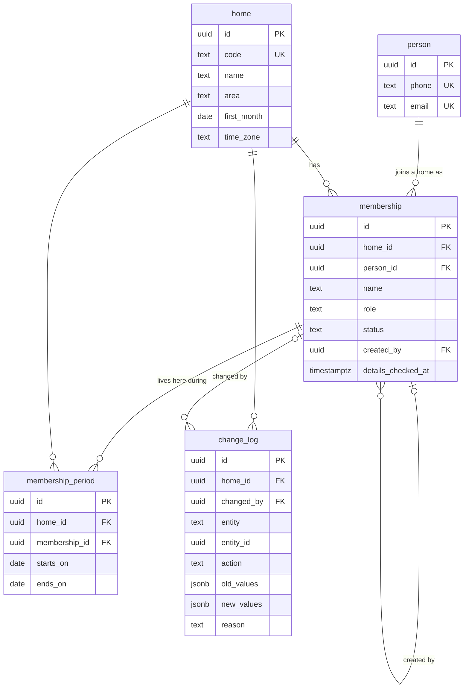

# Colivo — Data model

The living schema: what the database holds now and why. Each phase's
`requirements.md → Data model changes` holds only that phase's delta and
links here. Nothing here is decided without the user: `/feature-spec` step 4
(Gate 0) is the discussion, and this file records the result.

Status marks: _(Phase N, planned)_ when agreed in a spec, _(Phase N, built)_
once the phase's migrations are merged.

## Domain sketch _(agreed 19 Nov 2026)_

The main entities and how they relate, for **all** phases, from
`colivo-design/requirements.md`: no columns yet. The goal is that early
tables don't block later money flows. Columns are agreed at each phase's
Gate 0; entity names here are the working names until then, and the ledger's
detail tables (`entry_grocery`, `entry_bill_payment`, `entry_payment`) are
placeholders.

**The spine.** Six tables carry everything else: `person` (a login),
`home` (the tenant), `membership` (a person living in one home), `month`
(the billing cycle, open or closed), `fund` (a pot of shared cash) and
`entry` (one movement of money). Every other table hangs off `home`,
`membership` or `month`.

| Area                | Entities                                                                                                                        |
| ------------------- | ------------------------------------------------------------------------------------------------------------------------------- |
| People and access   | `person`, `membership`, `membership_period`, `fund_keeper`, `id_document`; log-in codes, lockouts and sessions in Redis (FR-94) |
| Home setup          | `room`, `room_assignment`, `home_rules_version`, `contact`, `contact_method`, `bill_category`                                   |
| Month               | `month`                                                                                                                         |
| Meals               | `meal_session`, `meal_session_day`, `meal_entry`                                                                                |
| Rent and charges    | `room_rent`, `rent_override`, `rent_revision`, `charge_override`, `bill_estimate`, `bill`                                       |
| Money ledger        | `fund`, `entry` and its detail tables, `landlord_deposit`                                                                       |
| Leaving and deposit | `leave_notice`, `settlement`; deposits are entry kinds, not a table                                                             |
| Inbox and messages  | `notification`, `conversation`, `conversation_member`, `message`                                                                |
| Audit and files     | `change_log`, `attachment`                                                                                                      |

```mermaid
erDiagram
  person ||--o{ membership : "joins a home as"
  home ||--o{ membership : has
  home ||--o{ month : "runs month by month"
  home ||--o{ fund : keeps
  membership ||--o{ membership_period : "lives here during"
  membership ||--o{ fund_keeper : "keeps funds via"
  fund ||--o{ fund_keeper : "kept by"
  membership ||--o{ id_document : has

  home ||--o{ room : has
  room ||--o{ room_assignment : ""
  membership ||--o{ room_assignment : "lives in"
  home ||--o{ home_rules_version : "effective-dated"
  home ||--o{ contact : "deals with"
  contact ||--o{ contact_method : "phones and emails"
  home ||--o{ bill_category : defines
  contact |o--o{ bill_category : "is paid to"

  home ||--o{ meal_session : has
  meal_session ||--o{ meal_session_day : "one per date"
  meal_session ||--o{ meal_entry : ""
  membership ||--o{ meal_entry : "own + guests"
  month ||--o{ meal_entry : ""

  room ||--o{ room_rent : "effective-dated"
  membership ||--o{ rent_override : "effective-dated"
  home ||--o{ rent_revision : ""
  rent_revision ||--o{ room_rent : writes
  rent_revision ||--o{ rent_override : writes
  membership ||--o{ charge_override : "fixed deal"
  bill_category ||--o{ charge_override : ""
  bill_category ||--o{ bill_estimate : "one month"
  bill_category ||--o{ bill : ""
  month ||--o{ bill : ""

  month ||--o{ entry : contains
  fund |o--o{ entry : "cash from or to"
  membership ||--o{ entry : "member, holder"
  entry |o--o{ entry : "return, correction, cancel"
  bill |o--o{ entry : "paid by"
  entry ||--o| entry_grocery : detail
  entry ||--o| entry_bill_payment : detail
  entry ||--o| entry_payment : detail
  home ||--o{ landlord_deposit : ""

  membership ||--o{ leave_notice : gives
  membership ||--o| settlement : "final settlement"
  settlement |o--o{ entry : writes

  membership ||--o{ notification : receives
  home ||--o{ conversation : "group and one-to-one"
  conversation ||--o{ conversation_member : ""
  membership ||--o{ conversation_member : ""
  conversation ||--o{ message : ""
  membership ||--o{ message : sends

  home ||--o{ change_log : ""
  membership |o--o{ change_log : "changed by"
  home ||--o{ attachment : ""
  membership |o--o| attachment : "profile photo"
  entry |o--o{ attachment : "receipt, proof"
  contact |o--o{ attachment : documents
  message |o--o{ attachment : photos
```

The choices behind the sketch are under [Decisions](#decisions): the
[ledger shape](#ledger-shape-one-header-table-agreed-19-nov-2026),
[person and membership](#person-and-membership-agreed-19-nov-2026),
[roles](#roles-agreed-19-nov-2026) and [the inbox](#inbox-worked-out-from-entries-agreed-19-nov-2026),
next to the earlier ledger, funds, meals and contacts decisions.

## Conventions

Project-wide rules that already apply are in
[tech-stack.md → Project conventions](tech-stack.md#project-conventions):
money is `numeric(12,2)` as `Decimal`, timestamps are timezone-aware, every
query is scoped to the current home, nothing is erased, and every money
change is one transaction.

Database-specific rules:

- Names are `snake_case` and **singular** (`home`, `meal_entry`). Foreign
  keys are `<table>_id`, except **actor columns**, which say who did
  something and point to `membership`: `<verb>_by` with no `_id`
  (`created_by`, `changed_by`, `confirmed_by`). See
  [Who made a record](#who-made-a-record-agreed-21-nov-2026). The login table is `person`, because `user` is a
  reserved word in PostgreSQL. SQLModel's default name is the class name
  lowercased (`MealEntry` → `mealentry`), so a shared base model sets
  `__tablename__` to the class name in snake_case. See
  [Table names](#table-names-singular-agreed-19-nov-2026).
- Every primary key is `id uuid`, a **UUIDv7** made by the backend. See
  [Primary keys](#primary-keys-uuidv7-agreed-19-nov-2026).
- Fixed value sets are `text` with a `CHECK`, from one Python `StrEnum`. See
  [Fixed value sets](#fixed-value-sets-text-and-check-agreed-19-nov-2026).
- Every home-owned table has `home_id NOT NULL` referencing `home`, and an
  index that starts with `home_id`.
- Every table has `created_at` and `updated_at` (`timestamptz`, set by the
  database), except append-only tables (`change_log`), which have only
  `created_at`.
- No `updated_by` column anywhere; `created_by` only where the record needs
  it ([Who made a record](#who-made-a-record-agreed-21-nov-2026)).
- No hard deletes of user data. Money entries follow the ledger rules in
  [Decisions](#decisions); other records follow
  [History of non-money records](#history-of-non-money-records-agreed-19-nov-2026).
- A rule a user could notice (unique, check, foreign key) is enforced in the
  database **and** listed as a behaviour in the phase's `validation.md`.
- One Alembic migration per `plan.md` group, edited on the phase branch until
  the group is done; a migration merged to `main` is never edited.

## Decisions

### Money storage: a ledger _(agreed 17 Nov 2026)_

Every money event is an **entry**, and every balance is computed from
entries: member credit and due, home fund cash, grocery fund cash and money
with shoppers. No balance column is the source of truth. A cached total may
be added later for speed (NFR-05), but it is always rebuilt from entries.

Rules (from `colivo-design/requirements.md` FR-17, FR-27, FR-90, FR-96,
FR-102, FR-103, NFR-07):

- **A confirmed entry is never updated or deleted.** A change is a new entry
  linked to the original: a return (FR-102), a correction (FR-103), a delete
  that cancels it in full (FR-96) or a closed-month correction (FR-90). The
  link column's name is settled at Gate 0.
- **Every entry has a status:** waiting, confirmed, rejected or withdrawn.
  Only confirmed entries count (FR-75, FR-91). A refund is confirmed by the
  member who received it (FR-17).
- **Effective amount** = the original plus its confirmed linked entries.
  Totals sum effective amounts, so the original's numbers stay as they were
  entered.
- **Months:** a linked entry counts in its original's month. If that month
  is closed, its statement shows the corrected figures and each member's
  difference is posted to the open month (FR-90).
- **Split funding:** an entry stores its shared part and its pocket part
  separately (FR-98), so a return can lower the pocket part first (FR-102).
- **A return can't exceed what is left of the original.** This compares
  rows, which a `CHECK` constraint can't do, so the service checks it inside
  the transaction after locking the original row (`SELECT … FOR UPDATE`);
  two returns sent at the same time can't both pass.

Why a ledger instead of stored balances:

- **Proof:** the app exists so "who paid what" is never argued about. With
  stored balances, an edit overwrites the old number; with a ledger, every
  step is a row anyone can trace (FR-22).
- **Closed months stay closed:** a correction is a new row, so a closed
  month's entries never change (FR-89, FR-90).
- **One way to check the maths:** recomputing every balance from entries is
  the October 2026 replay test (NFR-02); stored balances would need a second
  check that they still match their entries.

Entry kinds expected so far (columns at each phase's Gate 0): grocery
purchase, grocery fund top-up, bill, payment, refund, money given, money
handed back, handover, return, correction, and adjustment (closed-month
correction, estimate adjustment).

### Funds and holders _(agreed 17 Nov 2026)_

From `colivo-design/requirements.md` FR-62–FR-67, FR-104, FR-105, BR-23.

- **A fund is a row, not a hard-coded name.** A `fund` table per home
  starts with two rows, grocery fund and home fund. Custom funds (Release
  plan) then need no schema change, which keeps early tables from blocking
  later money flows.
- **A fund has a kind** _(added 19 Nov 2026)_: `grocery`, `home` or
  `custom`. Rules hang on the kind, not the name: grocery-fund spending feeds
  the cost per meal (BR-2), the home fund has reserved deposit cash (FR-32),
  and a custom fund has neither. `custom` is reserved; custom-fund screens
  come after the MVP. Their agreed shape (chosen members, a set amount split
  equally or open contributions, kept off the monthly bill) is in
  `colivo-design/requirements.md → Phase 4` and will need a fund-member link
  and a collection record then.
- **Every money entry that moves fund cash names its fund and its holder**
  (the person who received or paid the cash). A handover names two holders.
  Cash per holder (BR-23) and each fund's balance are sums over these
  entries; nothing is stored as a balance.
- **Money with shoppers is a holder balance** limited to one purpose (given
  for groceries or for a bill), so it is computed the same way as any
  holder's cash.
- **Who may hold a fund** comes from roles: the owner and managers hold any
  fund; fund keepers hold the funds they are chosen for. "Fund keeper of
  fund X" is a link between a membership and a fund, so one person can keep
  both funds and a fund can have several keepers.
- **The spending cap is per holder.** A holder's cash can't go below 0, and
  for the home fund free-to-spend (FR-32) can't either. Like the return cap,
  this compares rows, so the service checks it inside the transaction after
  locking the holder's fund rows; two spends at the same moment can't both
  pass.
- **A waiting handover or payment counts for nobody new:** until the
  receiver confirms, the money stays with the giver (and is locked) or, for
  a payment in, is in nobody's cash.

Why per holder instead of one total per fund: with two people holding the
same fund, one total lets a holder give out cash someone else has, and the
month-close cash count has no single person to check it against (G4).

### Meals: sessions, guests and confirmation _(agreed 19 Nov 2026)_

From `colivo-design/requirements.md` FR-08–FR-11, FR-106–FR-108, BR-2,
BR-24.

- **A meal session is a row, not a column.** Each home has its own
  sessions (breakfast, lunch, dinner) with an on/off flag, an order and a
  `weight` (`numeric`, default 1; breakfast can be 0.5). A home that adds
  or drops breakfast changes rows, not the schema, the same reasoning as
  funds.
- **A meal entry is one row per member, date and session** with two
  counts: `own` (0, 0.5 or 1) and `guests` (0 or more, steps of 0.5). Kept
  separate so a guest meal is visible later instead of hidden inside "2.0".
  Unique on (member, date, session).
- **A meal session day is one row per home, date and session.** It holds
  the home-guest count and the confirmation (`confirmed_by`,
  `confirmed_at`, empty until confirmed). One table for both, because both
  belong to the session of a day, not to a member.
- **Only confirmed sessions count.** Billable meals = Σ over confirmed
  sessions of (own + guests) × weight; home guests are never billable, so
  the books still balance (BR-1). Cook for = own + guests + home guests,
  without weights. Both are computed, not stored.
- **The lock is a rule, not a column.** A member can write a meal entry
  only while its session day is unconfirmed and its date is today or later
  (home time zone); the service checks it. Owner and manager edits after
  that go to the change log (FR-27).
- **Weights in closed months don't change:** a weight change applies to
  the open month, so a closed month's statement keeps the weights it was
  closed with (the weight used is recorded with the month at close, decided
  at the meals phase's Gate 0).

### Contacts and files _(agreed 19 Nov 2026)_

From `colivo-design/requirements.md` FR-109–FR-112.

- **One contact table for everyone the home deals with**, with a `kind`
  (landlord, cook, internet, electricity, gas, caretaker, other): name,
  optional photo, optional account / customer ID, note, `started_on` and
  `ended_on`. One table instead of landlord, cook and provider tables, so
  phones, emails and documents are handled once.
- **Phones and emails are rows in a contact method table** (`type` phone
  or email, `value`, `label`, `is_primary`), not JSON lists, so each value
  is validated and searchable, and a contact can have any number.
- **Never deleted:** a contact who leaves gets `ended_on` and shows in
  Past contacts. At most one active landlord per home.
- **Paid to:** a bill category has an optional payee contact (at most
  one). Each bill payment stores the contact it was paid to, so changing
  the cook never rewrites old payments.
- **One attachment table for every file** (contact documents, the lease,
  and later receipts and proof under FR-74), linked to what it belongs to
  by FK columns and link tables (see
  [Files](#files-s3-and-presigned-urls-agreed-21-nov-2026)). Sensitive files
  are encrypted, as ID documents are (FR-61).
- **Visibility is a service rule:** members get cook and provider names
  and phones only; landlord details, account IDs, notes and documents are
  for the owner and managers (FR-112).

### History of money entries _(agreed 17 Nov 2026)_

Money entries are append-only (above), so their history is the chain of
linked entries plus the change log (FR-27). History for other records is
[below](#history-of-non-money-records-agreed-19-nov-2026).

### Ledger shape: one header table _(agreed 19 Nov 2026)_

Every entry kind shares one `entry` table: amount, shared part and pocket
part, fund, holder (and the receiving holder for a handover), member,
status, month, and the link to the original entry. What only one kind has
(grocery items, the bill paid and whom it was paid to, payment method) is in
a small detail table, one row per entry at most.

Why: every balance (credits BR-6, central cash BR-8, cash per holder BR-23)
is a sum over one table, and returns, corrections and cancels link the same
way for every kind. Rejected: a table per kind (each balance becomes a
`UNION` over about eight tables, and the link logic is repeated in each),
and one wide table (mostly nulls, and per-kind `CHECK` rules get messy).

### Person and membership _(agreed 19 Nov 2026)_

`person` holds only the log-in identity: phone and email. Everything about
life in a home is on `membership`: name, photo, role, status, the stays in
`membership_period`, and the deposit and notice months copied from the home
rules on the join date (FR-29, BR-11). Entries, meals, ID documents and fund
keepers point to `membership`, never to `person`.

Why: a person who leaves one home and joins another keeps one login, while
each home's records stay separate (FR-85, NFR-03). "One active home per
person" is a partial unique index on `person_id` for active (later also
notice-served) memberships. _Phase 1b replaced this rule (built 23 Nov 2026): a person may be active in several homes; see [Current home per request](#current-home-per-request-agreed-22-nov-2026)._

**The name is on `membership`** _(settled at Phase 1 Gate 0, 21 Nov 2026)_:
each home names its own member when adding them, and "unique among a home's
active members, ignoring case" (FR-04) is a partial unique index on
`(home_id, lower(name))`. Rejected: `person.name` (the rule could only be
checked in the service) and a name on both (two names that drift apart). The
profile photo follows the name: `membership.photo_id` (Phase 2).

### Stays: membership periods _(agreed 21 Nov 2026)_

When a member lives in the home and is charged is a list of
`membership_period` rows (`starts_on`, `ends_on`), not columns on
`membership`. Deactivating closes the open period (FR-92); reactivating
opens a new one from the date charges start again. The join date is the
first period's start, and "I live here too" at sign-up (FR-83) means the
owner has a period: an owner who doesn't live there has none and is never
charged. Nothing is stored twice.

`membership.status` is separate: it says who may log in now. Statement
phases ask "who lived here in October" from periods.

Rejected: `joined_on` / `deactivated_on` / `reactivated_on` columns (a
second deactivation overwrites the first, so an old statement can't be
rebuilt) and status plus `change_log` (as-of queries would parse `jsonb`).
Overlapping periods are prevented by the service under a row lock, with one
open period per membership as a unique index; an exclusion constraint
(`btree_gist`) was left out as more than the rule needs.

### Current home per request _(agreed 22 Nov 2026)_

A person can be active in several homes (Phase 1b, replacing FR-85). The
log-in session stays "who you are"; **each request names its home** in the
`X-Colivo-Home` header, and the server uses the person's active membership
in that home for the role check and every query. Without the header, a
person with one active home gets that home and a person with several is
refused (409 `choose_home`); a home they aren't active in is 403
`not_in_home`, whether or not it exists. The web keeps the home per browser
tab.

Why: each tab is independent, so a form in a tab showing one home can never
save into another home after a switch in a second tab; no server state; the
mobile app sends the same header. Rejected: the current membership in the
Redis session (one home for every tab sharing the cookie, so a write can
land in the wrong home) and `/homes/{home_id}/…` API paths (rewrites every
Phase 1 endpoint for the same guarantee).

"One active home per person" goes: its unique index becomes a plain partial
index serving "this person's active homes". `(home_id, person_id)` UNIQUE
still allows one membership per person per home.

### Sessions in Redis _(agreed 21 Nov 2026)_

A log-in session is a random token in an httpOnly cookie; Redis keeps only
its SHA-256 hash and the `person_id`, for 30 days from the last use. Every
request reads the active membership from PostgreSQL, so deactivating a
member logs them out at once. Rejected: a `session` table (one more table
and a clean-up job; losing Redis only logs people out).

### Who made a record _(agreed 21 Nov 2026)_

- **No `updated_by` anywhere.** `change_log` keeps every change with who,
  when and the old and new values; an `updated_by` column keeps only the
  last editor and would be a second, weaker copy.
- **`created_by` only where the record needs it**, because a rule or a
  screen uses it: `membership` ("Added by Rabbi Hasan", null for the owner),
  `attachment` (who uploaded it), `entry` (FR-75: who entered it decides who
  confirms it). Not on `person` or `home` (the owner's membership is created
  with the home and points back to it).
- **Actor columns are `<verb>_by`**, a foreign key to `membership` with no
  `_id` suffix: `created_by`, `changed_by`, `confirmed_by` (user's choice).
- `change_log.changed_by` points to `membership`, not `person`: every change
  is made inside a home, and history shows the name used there.

Rejected: `created_by` and `updated_by` on every table through the base
model (duplicates `change_log`, a membership key on every table, and no
sensible value on `home` or `person`).

### Files: S3 and presigned URLs _(agreed 21 Nov 2026)_

Every uploaded file (profile photos, ID documents, contact documents, the
lease, home and room photos, receipts, proof, message photos) is an
`attachment` row; the bytes are in a **private S3 bucket** (MinIO locally),
never in PostgreSQL and never sent through the API.

1. The client asks the API for an upload (`purpose`, `content_type`,
   `size_bytes`, `filename`). The API checks the role and the purpose's
   allowed types and size, inserts `attachment` with status `pending`, and
   returns a **presigned POST** for the key `homes/<home_id>/<attachment_id>`.
   A POST policy, unlike a presigned PUT, makes S3 itself enforce
   `content-length-range` and the content type.
2. The client uploads straight to S3.
3. The client tells the API it is done; the API checks the object's size
   and type and sets status `ready`.
4. The record that uses it is saved with the attachment's id; only a
   `ready` attachment of the same home is accepted.
5. To view a file, the API checks access (home scope, FR-61, FR-112) and
   returns a **presigned GET** valid for about 5 minutes. No file has a
   public URL.

Sensitive files (ID documents, contact documents) use SSE-KMS; the rest the
bucket's default encryption. Uploads left `pending` are removed by a
clean-up job after 24 hours.

**Linking** _(settles the open question)_: a record with one file has an
FK column (`membership.photo_id`); a record with several has a small link
table (`contact_document`, `entry_attachment`). Rejected: an `owner_type` +
`owner_id` pair on `attachment` (no foreign key, so a wrong id points at
nothing and nobody notices). Columns are agreed at Phase 2's Gate 0, where
`attachment` is built.

### Roles _(agreed 19 Nov 2026)_

`membership.role` is `owner`, `manager` or `member`. Fund keeper is not a
role value but a `fund_keeper` link between a membership and a fund, with
`started_on` and `ended_on`, so one person can keep both funds and a fund can
have several keepers (FR-65). "Exactly one owner per home" (FR-63) is a
partial unique index on `home_id` where `role = 'owner'`. No roles table:
the roles are fixed, and a person is owner or manager, never both.

### Inbox: worked out from entries _(agreed 19 Nov 2026)_

Items waiting for someone (payments, handovers, returns, corrections and
refunds to confirm) are not stored: they are entries with status `waiting`
whose confirmer is that person (FR-75, FR-76). Only updates and notices
(rent changed, notice given, "the owner corrected your entry") are stored,
in `notification`.

Why: storing waiting items twice lets them disagree, such as a confirmed
entry still showing as "to confirm".

### History of non-money records _(agreed 19 Nov 2026)_

Two needs, solved separately:

- **Values a calculation needs as of a month** (room rent, member rent
  override, home rules, room assignment): **effective-dated rows**, modelled
  as normal tables (`room_rent`, `rent_override`, `home_rules_version`,
  `room_assignment`). October's statement always uses October's values
  (FR-51, FR-28).
- **Proof of who changed what** (FR-27, US-A13): **one `change_log` table**
  (entity, id, who, when, old and new values as `jsonb`, reason), written by
  the service in the same transaction as the change.
- **Removing:** never a delete. Records get `archived_at` (rooms, bill
  categories), `ended_on` (contacts, fund keepers) or a status (members),
  per FR-96 and FR-110.

Rejected: an audit table per entity (about twenty near-identical tables)
and versioned rows on every table (every query needs date filters, even for
a phone number).

### Primary keys: UUIDv7 _(agreed 19 Nov 2026)_

Every table's key is `id uuid` holding a **UUIDv7**, made in Python with the
standard library's `uuid.uuid7()` (Python 3.14; PostgreSQL 16 has no
`uuidv7()`). No extra package: the `uuid-utils` package planned for Python
3.12 is not needed since the backend moved to 3.14 in Phase 0.

- **Safe in URLs:** ids can't be guessed, and they don't reveal how many
  homes or entries exist.
- **Time-ordered:** new rows go at the end of the index, so inserts stay
  compact, almost like a counter.
- **Made before the insert:** the client can send the id with a create, so a
  retried save on slow mobile data reuses it and never counts twice
  (NFR-08).
- **Size:** PostgreSQL stores a `uuid` as 16 bytes (the 36-character form is
  only how it is shown). A 12-character text id would be 13 bytes, and
  `bigint` 8; the difference is negligible at Colivo's size.

The short Home ID shown in settings (`OF-4827`, FR-88) is a separate unique
code on `home`, not its key.

### Fixed value sets: text and CHECK _(agreed 19 Nov 2026)_

Roles, entry kinds, statuses, fund kinds, contact kinds and bill classes are
`text` columns with a `CHECK (col IN (…))`. Each set is one Python `StrEnum`;
the model and the migration's check are built from it, and a test compares
the database check with the enum so the two can't drift.

Why: a value is added or removed with a normal migration that drops and
recreates the check, and the values read plainly in `psql`. Rejected:
PostgreSQL `enum` types (values can't be removed or renamed easily, and
Alembic autogenerate handles them badly) and lookup tables (not needed:
everything users define, such as funds, meal sessions and bill categories,
is already a real table).

### Table names: singular _(agreed 19 Nov 2026)_

`home`, `membership`, `meal_entry`, matching the names used throughout this
file. The login table is `person` because `user` is reserved in PostgreSQL
and would need quoting everywhere.

## Open questions

None open across the whole schema. Left to the phase that first needs them,
at its Gate 0:

| Question                                                                | Phase that decides |
| ----------------------------------------------------------------------- | ------------------ |
| How session weights are kept with a month at close                      | Meals              |
| Carried bills: their own rows, or unpaid `bill` rows from closed months | Month close        |
| Landlord deposit settlement at move-out                                 | Release Phase 2    |

## ER diagram

The tables agreed so far, with their status marks under [Tables](#tables).

## Tables

Each table has a `| Column | Type | Null | Default | Constraint | Why |`
table, its indexes and the query each serves, and its status mark. Every
table also has `created_at` and `updated_at` (`timestamptz`, default
`now()`) unless noted; they are left out of the column tables.

### person _(Phase 1, built)_

A log-in identity, shared across homes. Nothing about life in a home.

| Column | Type | Null | Default | Constraint                           | Why                                                                              |
| ------ | ---- | ---- | ------- | ------------------------------------ | -------------------------------------------------------------------------------- |
| id     | uuid | no   | UUIDv7  | PK                                   | Convention                                                                       |
| phone  | text | yes  | —       | UNIQUE; CHECK `^\+[1-9][0-9]{7,14}$` | E.164 (`01712 345678` → `+8801712345678`), so one number can't become two people |
| email  | text | yes  | —       | UNIQUE; CHECK `email = lower(email)` | Log-in by email, stored in lower case                                            |

CHECK `phone IS NOT NULL OR email IS NOT NULL`.

| Index                  | Serves                                   |
| ---------------------- | ---------------------------------------- |
| `person(phone)` UNIQUE | Finding the person on log-in and sign-up |
| `person(email)` UNIQUE | The same, by email                       |

### home _(Phase 1, built)_

The tenant. Every home-owned table points here.

| Column      | Type | Null | Default        | Constraint                          | Why                                                                                  |
| ----------- | ---- | ---- | -------------- | ----------------------------------- | ------------------------------------------------------------------------------------ |
| id          | uuid | no   | UUIDv7         | PK                                  | Convention                                                                           |
| code        | text | no   | generated      | UNIQUE; CHECK `^[A-Z]{2}-[0-9]{4}$` | Home ID `OF-4827` for support (FR-88); two letters from the name, four random digits |
| name        | text | no   | —              | CHECK 1–80 characters after trim    | FR-83                                                                                |
| area        | text | yes  | —              | CHECK at most 80 characters         | Optional at sign-up                                                                  |
| first_month | date | no   | —              | CHECK day of month = 1              | "First month" at sign-up; seeds the `month` table in Phase 3                         |
| time_zone   | text | no   | `'Asia/Dhaka'` | —                                   | NFR-10; "today" for join and deactivation dates, the meal lock in Phase 3            |

| Index               | Serves              |
| ------------------- | ------------------- |
| `home(code)` UNIQUE | Home ID for support |

### membership _(Phase 1, built)_

_Phase 1b, built: one index change, no column change (below), in `a8f729dfae84_several_homes`._

A person in one home. Everything in a home points here, never to `person`.

| Column             | Type        | Null | Default    | Constraint                              | Why                                                                                                        |
| ------------------ | ----------- | ---- | ---------- | --------------------------------------- | ---------------------------------------------------------------------------------------------------------- |
| id                 | uuid        | no   | UUIDv7     | PK                                      | Convention                                                                                                 |
| home_id            | uuid        | no   | —          | FK `home`                               | Tenant                                                                                                     |
| person_id          | uuid        | no   | —          | FK `person`                             | The log-in                                                                                                 |
| name               | text        | no   | —          | CHECK 1–80 characters after trim        | The name in this home (FR-04, FR-86)                                                                       |
| role               | text        | no   | `'member'` | CHECK in (`owner`, `manager`, `member`) | [Roles](#roles-agreed-19-nov-2026)                                                                         |
| status             | text        | no   | `'active'` | CHECK in (`active`, `inactive`)         | Who may log in now (FR-80); Phase 7 adds `notice_served`                                                   |
| created_by         | uuid        | yes  | —          | FK `membership`                         | Who added them ("Added by Rabbi Hasan"); null for the owner. Group 4 migration                             |
| details_checked_at | timestamptz | yes  | —          | —                                       | The first log-in check (FR-86) is shown until this is set; set at sign-up for the owner. Group 4 migration |

CHECK `role <> 'owner' OR status = 'active'`: the owner can't be
deactivated.

| Index                                                             | Serves                                                                                                                                          |
| ----------------------------------------------------------------- | ----------------------------------------------------------------------------------------------------------------------------------------------- |
| `membership(home_id, person_id)` UNIQUE                           | The members list per home; one membership per person per home, so a returning member is reactivated                                             |
| `membership(person_id) WHERE status = 'active'` UNIQUE            | One active home per person (FR-85). _(Phase 1b, built: dropped, `uq_membership_active_person_id`)_                                              |
| `membership(person_id) WHERE status = 'active'`                   | A person's active homes: log-in, the home picker and switcher, the `X-Colivo-Home` check. _(Phase 1b, built: `ix_membership_active_person_id`)_ |
| `membership(home_id) WHERE role = 'owner'` UNIQUE                 | Exactly one owner per home (FR-63)                                                                                                              |
| `membership(home_id, lower(name)) WHERE status = 'active'` UNIQUE | Names unique among active members, ignoring case (FR-04)                                                                                        |

### membership_period _(Phase 1, built)_

The stays: when a member lives here and is charged
([Stays](#stays-membership-periods-agreed-21-nov-2026)).

| Column        | Type | Null | Default | Constraint                   | Why                                                    |
| ------------- | ---- | ---- | ------- | ---------------------------- | ------------------------------------------------------ |
| id            | uuid | no   | UUIDv7  | PK                           | Convention                                             |
| home_id       | uuid | no   | —       | FK `home`                    | Tenant                                                 |
| membership_id | uuid | no   | —       | FK `membership`              |                                                        |
| starts_on     | date | no   | —       | —                            | The join date, or the date charges start again (FR-92) |
| ends_on       | date | yes  | —       | CHECK `ends_on >= starts_on` | The deactivation date; null while the stay is open     |

| Index                                                           | Serves                                                                                                            |
| --------------------------------------------------------------- | ----------------------------------------------------------------------------------------------------------------- |
| `membership_period(membership_id) WHERE ends_on IS NULL` UNIQUE | At most one open stay per member                                                                                  |
| `membership_period(home_id, membership_id, starts_on)`          | A member's stays; "who lived here in October" (Phase 6). _Not built yet: added with the first query that uses it_ |

### change_log _(Phase 1, built)_

Proof of who changed what (FR-27,
[History of non-money records](#history-of-non-money-records-agreed-19-nov-2026)).
Append-only: `created_at` only, no `updated_at`. Created by the group 4
migration.

| Column     | Type  | Null | Default | Constraint                                                    | Why                                                        |
| ---------- | ----- | ---- | ------- | ------------------------------------------------------------- | ---------------------------------------------------------- |
| id         | uuid  | no   | UUIDv7  | PK                                                            | Convention                                                 |
| home_id    | uuid  | no   | —       | FK `home`                                                     | Tenant                                                     |
| changed_by | uuid  | yes  | —       | FK `membership`                                               | Who; null for system changes (month close, Phase 6)        |
| entity     | text  | no   | —       | CHECK from `ChangeEntity` (`membership`, `membership_period`) | What was changed; later phases add values                  |
| entity_id  | uuid  | no   | —       | —                                                             | Which row                                                  |
| action     | text  | no   | —       | CHECK in (`create`, `update`, `delete`)                       | `delete` is the soft delete of Phase 8                     |
| old_values | jsonb | yes  | —       | —                                                             | Null on create                                             |
| new_values | jsonb | yes  | —       | —                                                             | Null on delete                                             |
| reason     | text  | yes  | —       | —                                                             | Optional now; required for edits and deletes later (FR-77) |

| Index                                                | Serves                    |
| ---------------------------------------------------- | ------------------------- |
| `change_log(home_id, entity, entity_id, created_at)` | The history of one record |

Redis, not tables (Phase 1): one-time codes, wrong-code counts, locks, send
limits and sessions; see
[Phase 1 requirements → API](2026-11-21-accounts-and-login/requirements.md#api).

## Change log

| Phase                  | Change                                                                                                                                                                                                                                                        |
| ---------------------- | ------------------------------------------------------------------------------------------------------------------------------------------------------------------------------------------------------------------------------------------------------------- |
| Design (17 Nov 2026)   | Money storage decided as a ledger; returns and corrections are linked entries                                                                                                                                                                                 |
| Design (17 Nov 2026)   | Funds are rows; fund cash is tracked per holder; fund keeper is chosen per fund                                                                                                                                                                               |
| Design (19 Nov 2026)   | Meal sessions are rows with a weight; own and guest meals stored apart; home guests and confirmation per session day                                                                                                                                          |
| Design (19 Nov 2026)   | One contact table with phones and emails as rows; one attachment table; payee per bill category; fund kind added                                                                                                                                              |
| Design (19 Nov 2026)   | Domain sketch agreed for all phases; ledger is one header table with detail tables; person and membership split                                                                                                                                               |
| Design (19 Nov 2026)   | UUIDv7 keys (`uuid-utils`), text + `CHECK` value sets, singular table names, effective-dated rows plus one change log                                                                                                                                         |
| Phase 0                | UUIDv7 keys from the standard library's `uuid.uuid7()` (Python 3.14), replacing the planned `uuid-utils` package                                                                                                                                              |
| Phase 0                | No tables; Alembic set up with no revisions, the test database built with `alembic upgrade head`; first table in Phase 1                                                                                                                                      |
| Phase 1 (21 Nov 2026)  | Planned `person`, `home`, `membership`, `membership_period`, `change_log`; name on `membership`; stays as periods; sessions in Redis                                                                                                                          |
| Phase 1 (21 Nov 2026)  | Actor columns `created_by` / `changed_by` (no `_id`), no `updated_by`; files in private S3 via presigned POST and GET, linked by FK columns and link tables                                                                                                   |
| Phase 1 (built)        | Built in `e56c6933166b_sign_up`, `d0fcb4a7b7ad_add_members` and `2b0784c0023a_member_status`; constraint names follow the naming convention (`uq_`, `ck_`, `ix_`); the `membership_period(home_id, membership_id, starts_on)` index waits for its first query |
| Phase 1 (21 Nov 2026)  | Phase 1b planned: a person in several homes replaces "one active home per person" (FR-85), after the security review                                                                                                                                          |
| Phase 1b (22 Nov 2026) | Planned: drop the unique index on active `membership(person_id)`, add a plain one; the current home travels per request in `X-Colivo-Home`, sessions unchanged. Settles the open question on several homes                                                    |
| Phase 1b (built)       | Built in `a8f729dfae84_several_homes`: `uq_membership_active_person_id` dropped, `ix_membership_active_person_id` (partial, not unique) added; Phase 1 data migrates unchanged                                                                                |
